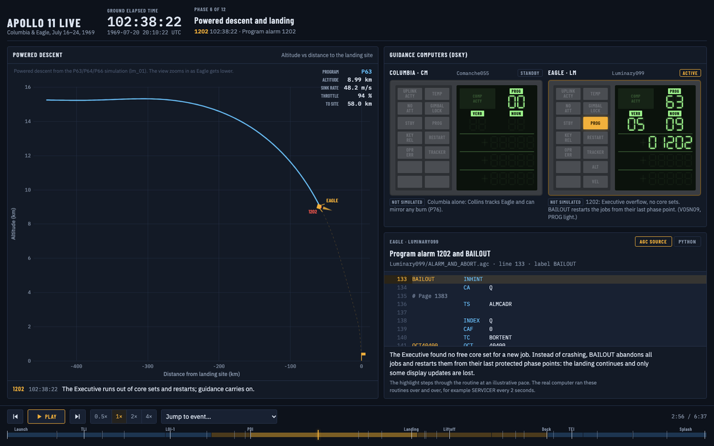

# Apollo 11 Explained

**[Watch the live mission replay →](https://martha889.github.io/apollo-11-explained/)**

[](https://martha889.github.io/apollo-11-explained/)

The software that flew Apollo 11 to the Moon, made readable. This repository pairs the original Apollo Guidance Computer (AGC) assembly with Python translations of its key algorithms. It also has a step-by-step replay of the whole mission.

- **[Live mission viewer](https://martha889.github.io/apollo-11-explained/)**: launch to splashdown on the real mission clock. Three panels show where the spacecraft was, what Columbia's and Eagle's DSKYs displayed (including the 1202 and 1201 program alarms), and the AGC source that was running at that moment, with a voice loop of the crew's and Mission Control's actual words. Jump straight to an event: [powered descent](https://martha889.github.io/apollo-11-explained/#pdi), [1202 alarm](https://martha889.github.io/apollo-11-explained/#alarm-1202), [touchdown](https://martha889.github.io/apollo-11-explained/#touchdown), [entry](https://martha889.github.io/apollo-11-explained/#entry-interface).
- **[`explained/`](explained/)**: Python walkthroughs, from how the AGC worked (ones'-complement numbers, the Executive and Waitlist, the interpreter, the DSKY) through every mission phase: the P11 launch monitor, free-return coast, P52 star alignment, P40 burns, P63–P66 landing guidance, P12 ascent, rendezvous and P61–P67 entry. Each module cites the original routines by file and label, and saves figures to [`explained/figures/`](explained/figures/).
- **[`Comanche055/`](Comanche055/)** and **[`Luminary099/`](Luminary099/)**: the original flight software for the Command Module *Columbia* and the Lunar Module *Eagle*, unchanged.

## Run it locally

```bash
python -m venv .venv && source .venv/bin/activate
pip install -r explained/requirements.txt
python explained/mission.py              # narrated walkthrough of all 12 phases, writes the figures
python explained/live/build.py           # builds explained/live/apollo11_live.html
open explained/live/apollo11_live.html   # works offline
```

See [`explained/README.md`](explained/README.md) for the module guide, the mission timeline and the simplifications made.

## How the viewer is built

[`explained/live/build.py`](explained/live/build.py) reruns the simulations, places them on the real Apollo 11 timeline from the Mission Report, and quotes the matching AGC source lines straight from `Comanche055/` and `Luminary099/`. It then writes everything into one self-contained HTML page. A [GitHub Actions workflow](.github/workflows/pages.yml) rebuilds and deploys the page on every push to `main`.

## Credits

The AGC software was written at the MIT Instrumentation Laboratory, led by Margaret Hamilton (CM and LM flight software) and many others. The source here was transcribed by the [Virtual AGC](https://www.ibiblio.org/apollo/) project and comes from [chrislgarry/Apollo-11](https://github.com/chrislgarry/Apollo-11).

## Licence

- `Comanche055/` and `Luminary099/`: the original AGC source, in the public domain (see [AGC-LICENSE.md](AGC-LICENSE.md)).
- `explained/` (the Python walkthroughs, figures and live viewer): [MIT](explained/LICENSE).
