# Apollo 11 AGC Explained — Readable Python Walkthroughs

The **Apollo Guidance Computer (AGC)** was a 15-bit real-time digital flight computer built by the MIT Instrumentation Laboratory that navigated and controlled the Apollo spacecraft using 36,864 words of fixed core-rope ROM and 2,048 words of erasable magnetic-core RAM.
**[Comanche055](../Comanche055/)** is the flight software for the Command Module *Columbia* (handling Earth launch monitoring, translunar navigation, optical star alignment, Service Propulsion System burns, and atmospheric entry).
**[Luminary099](../Luminary099/)** is the flight software for the Lunar Module *Eagle* (handling powered lunar descent, surface liftoff, Rendezvous Radar Kalman filtering, and lunar orbit rendezvous).

---

## How to Run

From the repository root:

```bash
python -m venv .venv
source .venv/bin/activate
pip install -r explained/requirements.txt
python explained/mission.py
```

Useful CLI flags for [`mission.py`](mission.py):

```bash
python explained/mission.py --list          # List all prologue and flight phases
python explained/mission.py --no-intro      # Skip the agc_00..agc_03 computer architecture prologue
python explained/mission.py --only lm_02    # Run a single phase by short ID, module name, or number
```

---

## Live Mission Viewer

[`live/`](live/) holds an animated, single-page replay of the whole flight, from launch to splashdown, on the real mission clock. It has three linked panels:

- **Trajectory**: the spacecraft's path, with a view that changes with each phase (Earth orbit, the Earth–Moon figure-8, lunar orbit, the descent profile, rendezvous, entry).
- **Guidance computers**: Columbia's and Eagle's DSKYs as the crew saw them. They show the program, verb, noun, registers and warning lights, including the 1202/1201 alarms.
- **Voice loop**: what the crew and Mission Control said at that moment, verbatim and timed to the GET, from NASA's transcripts as published in the [Apollo Flight Journal](https://apollojournals.org/afj/) and [Apollo Lunar Surface Journal](https://apollojournals.org/alsj/) (lines and sources in [`live/transcript.json`](live/transcript.json)).
- **Code**: the AGC source that was running at that moment, quoted line for line from `Comanche055/` and `Luminary099/`, next to its Python translation from this folder.

```bash
python explained/live/build.py          # reruns the simulations, writes explained/live/apollo11_live.html
open explained/live/apollo11_live.html  # any browser; works offline from file://
```

Controls: Space to play or pause, the Left/Right arrows to jump between events, and a speed selector (the full mission plays in about 6.5 minutes at 1×). You can also link to an event directly with a hash such as `apollo11_live.html#pdi`, `#alarm-1202`, `#touchdown` or `#entry-interface`. Every DSKY caption says whether its numbers come from a simulation or show only the program the crew would have had up. Notes in the trajectory panel say where a simulation was retimed onto the real ground elapsed time.

---

## Mission Timeline & Module Index

| Phase | Approx. GET | AGC Program(s) | Original Source Files | Python Module | Figures |
| :--- | :--- | :--- | :--- | :--- | :--- |
| **Prologue 0: AGC Numbers & Scaling** | Pre-launch | 15-bit SP/DP, `B-n` scaling | [FIXED_FIXED_CONSTANT_POOL.agc](../Luminary099/FIXED_FIXED_CONSTANT_POOL.agc), [CONTROLLED_CONSTANTS.agc](../Luminary099/CONTROLLED_CONSTANTS.agc), [INTERPRETER.agc](../Luminary099/INTERPRETER.agc) | [agc_00_numbers.py](agc_00_numbers.py) | [bit_layout](figures/agc_00_bit_layout.png), [scaling_precision](figures/agc_00_scaling_precision.png) |
| **Prologue 1: Executive, Waitlist & 1202 Alarm** | Pre-launch / `102:38` | `EXEC`, `WAITLIST`, `BAILOUT` | [EXECUTIVE.agc](../Luminary099/EXECUTIVE.agc), [WAITLIST.agc](../Luminary099/WAITLIST.agc), [ALARM_AND_ABORT.agc](../Luminary099/ALARM_AND_ABORT.agc), [RESTARTS_ROUTINE.agc](../Luminary099/RESTARTS_ROUTINE.agc), [PHASE_TABLE_MAINTENANCE.agc](../Luminary099/PHASE_TABLE_MAINTENANCE.agc) | [agc_01_executive_waitlist.py](agc_01_executive_waitlist.py) | [gantt_timeline](figures/agc_01_gantt_timeline.png), [coreset_occupancy](figures/agc_01_coreset_occupancy.png) |
| **Prologue 2: Vector/Matrix Interpreter** | Pre-launch | `INTPRET`, `RGVGCALC` | [INTERPRETER.agc](../Luminary099/INTERPRETER.agc), [RTB_OP_CODES.agc](../Luminary099/RTB_OP_CODES.agc), [LUNAR_LANDING_GUIDANCE_EQUATIONS.agc](../Luminary099/LUNAR_LANDING_GUIDANCE_EQUATIONS.agc) | [agc_02_interpreter.py](agc_02_interpreter.py) | [interpreter_trace](figures/agc_02_interpreter_trace.png) |
| **Prologue 3: DSKY & PINBALL Interface** | Pre-launch / `102:38` | `PINBALL`, `V16N68`, `V05N09` | [PINBALL_GAME_BUTTONS_AND_LIGHTS.agc](../Luminary099/PINBALL_GAME_BUTTONS_AND_LIGHTS.agc), [PINBALL_NOUN_TABLES.agc](../Luminary099/PINBALL_NOUN_TABLES.agc), [KEYRUPT_UPRUPT.agc](../Luminary099/KEYRUPT_UPRUPT.agc) | [agc_03_dsky.py](agc_03_dsky.py) | [dsky_panels](figures/agc_03_dsky_panels.png), [verbs_nouns_programs](figures/agc_03_verbs_nouns_programs.png) |
| **1. Saturn V Launch & EOI Monitor** | `000:00` – `000:12` | Comanche `P11` (`N62`) | [P11.agc](../Comanche055/P11.agc), [SERVICER207.agc](../Comanche055/SERVICER207.agc) | [csm_01_earth_orbit_p11.py](csm_01_earth_orbit_p11.py) | [p11_ascent_monitor](figures/csm_01_p11_ascent_monitor.png) |
| **2. Translunar Coast & Conics** | `002:50` – `075:49` | Comanche `P00`/`P20`, Conics, Encke | [CONIC_SUBROUTINES.agc](../Comanche055/CONIC_SUBROUTINES.agc), [ORBITAL_INTEGRATION.agc](../Comanche055/ORBITAL_INTEGRATION.agc), [TIME_OF_FREE_FALL.agc](../Comanche055/TIME_OF_FREE_FALL.agc) | [csm_02_conics_coast.py](csm_02_conics_coast.py) | [translunar_coast](figures/csm_02_translunar_coast.png), [kepler_convergence](figures/csm_02_kepler_convergence.png) |
| **3. IMU Star Alignment** | `~073:30` (pre-burns) | Comanche `P52` (`N05`, `N93`) | [P51-P53.agc](../Comanche055/P51-P53.agc), [INFLIGHT_ALIGNMENT_ROUTINES.agc](../Comanche055/INFLIGHT_ALIGNMENT_ROUTINES.agc), [STAR_TABLES.agc](../Comanche055/STAR_TABLES.agc), [SXTMARK.agc](../Comanche055/SXTMARK.agc), [CSM_GEOMETRY.agc](../Comanche055/CSM_GEOMETRY.agc) | [csm_03_imu_alignment_p52.py](csm_03_imu_alignment_p52.py) | [star_catalog_sky](figures/csm_03_star_catalog_sky.png), [imu_alignment_axes](figures/csm_03_imu_alignment_axes.png) |
| **4. Lunar Orbit Insertion (LOI-1)** | `075:50` – `075:56` | Comanche `P30`, `P40` (`N40`, `N44`) | [P30-P37.agc](../Comanche055/P30-P37.agc), [P34-35_P74-75.agc](../Comanche055/P34-35_P74-75.agc), [P40-P47.agc](../Comanche055/P40-P47.agc), [SERVICER207.agc](../Comanche055/SERVICER207.agc) | [csm_04_burns_p30_p40.py](csm_04_burns_p30_p40.py) | [loi1_orbit_capture](figures/csm_04_loi1_orbit_capture.png), [p40_burn_telemetry](figures/csm_04_p40_burn_telemetry.png) |
| **5. LM Powered Descent & Landing** | `102:33` – `102:46` | Luminary `P63`, `P64`, `P66` | [THE_LUNAR_LANDING.agc](../Luminary099/THE_LUNAR_LANDING.agc), [LUNAR_LANDING_GUIDANCE_EQUATIONS.agc](../Luminary099/LUNAR_LANDING_GUIDANCE_EQUATIONS.agc), [THROTTLE_CONTROL_ROUTINES.agc](../Luminary099/THROTTLE_CONTROL_ROUTINES.agc), [SERVICER.agc](../Luminary099/SERVICER.agc) | [lm_01_powered_descent.py](lm_01_powered_descent.py) | [trajectory](figures/lm_01_trajectory.png), [throttle_vel_pitch](figures/lm_01_throttle_vel_pitch.png), [dsky_n63_n64](figures/lm_01_dsky_n63_n64.png) |
| **6. LM Powered Ascent** | `124:22` – `124:29` | Luminary `P12` | [P12.agc](../Luminary099/P12.agc), [ASCENT_GUIDANCE.agc](../Luminary099/ASCENT_GUIDANCE.agc), [CONTROLLED_CONSTANTS.agc](../Luminary099/CONTROLLED_CONSTANTS.agc) | [lm_02_ascent_p12.py](lm_02_ascent_p12.py) | [altitude_velocity](figures/lm_02_altitude_velocity.png), [pitch_profile](figures/lm_02_pitch_profile.png) |
| **7. Lunar Orbit Rendezvous** | `125:19` – `128:03` | Luminary `P20`, `P32`–`P35` | [P20-P25.agc](../Luminary099/P20-P25.agc), [MEASUREMENT_INCORPORATION.agc](../Luminary099/MEASUREMENT_INCORPORATION.agc), [P32-P35_P72-P75.agc](../Luminary099/P32-P35_P72-P75.agc), [P34-35_P74-75.agc](../Luminary099/P34-35_P74-75.agc) | [lm_03_rendezvous.py](lm_03_rendezvous.py) | [lvlh_trajectory](figures/lm_03_lvlh_trajectory.png), [kalman_filter](figures/lm_03_kalman_filter.png) |
| **8. Earth Atmospheric Entry** | `195:03` – `195:19` | Comanche `P61`, `P63`–`P67` | [P61-P67.agc](../Comanche055/P61-P67.agc), [REENTRY_CONTROL.agc](../Comanche055/REENTRY_CONTROL.agc) | [csm_05_entry_p61_p67.py](csm_05_entry_p61_p67.py) | [entry_profile_phases](figures/csm_05_entry_profile_phases.png), [entry_gload_and_bank](figures/csm_05_entry_gload_and_bank.png) |

---

## Module Guide

### `agc_00_numbers.py` — AGC Number Representation & Fixed-Point Scaling
The Block II AGC had no floating-point hardware; every quantity in `Luminary099` and `Comanche055` is stored in 15-bit ones'-complement words (Bit 15 = sign, Bits 14..1 = magnitude, plus a memory-only odd-parity bit) using binary `B-n` fractional scaling. This module encodes and decodes single-precision (`DEC`, 14 magnitude bits) and double-precision (`2DEC`, 28 magnitude bits with sign agreement) constants from `Luminary099`, including the `-0` (`OCT 77777`) sentinel that the Executive uses to mark empty Core Sets.

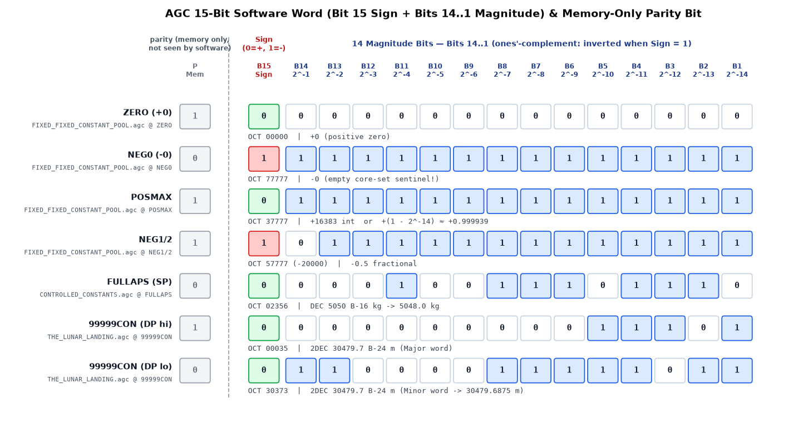

### `agc_01_executive_waitlist.py` — Executive, Waitlist, Phase Tables & 1201/1202 Alarms
Translates the AGC's ~1,000-word real-time operating system: the priority-scheduled `EXECUTIVE` (managing 8 Core Sets and 5 44-word Vector Accumulator areas), the `TIME3`/`T3RUPT` delta-time `WAITLIST` queue, and the `PHASCHNG` restart table (`-PHASEn`/`PHASEn`). Running the lunar landing task load with 15% Rendezvous Radar CDU cycle-stealing reproduces the famous `1202` (no Core Sets) and `1201` (no VAC areas) alarms, showing how `BAILOUT` -> `ENEMA` -> `RESTARTS` drops low-priority `V16N68` display jobs while immediately resuming `SERVICER` and `LUNLAND`.

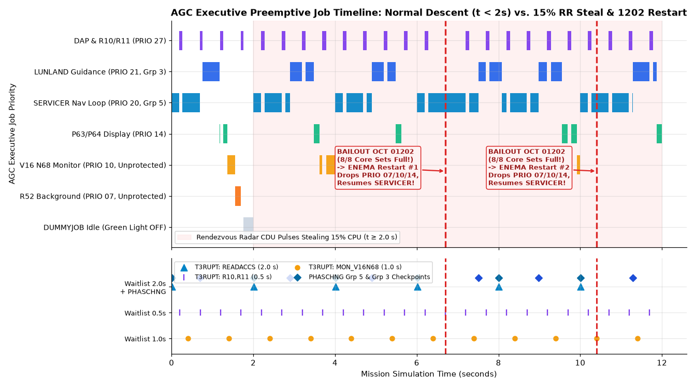

### `agc_02_interpreter.py` — Hal Laning's Vector/Matrix Bytecode Interpreter
Because basic AGC instructions only operate on 15-bit scalars, 3D navigation and guidance laws run inside `INTERPRETER.agc`, a stack-based virtual machine that packs two 7-bit opcodes into each 15-bit word and manages a 38-word push-down list (`PUSHLOC`) in the job's VAC area. This module executes the real Lunar Module routine `RGVGCALC` instruction-by-instruction (`VLOAD`, `VXV`, `VAD`, `MXV`, `PDDL`, `VDEF`, `ABVAL`, `STOVL`, `RTB NORMUNIT`, `DOT`), tracing `MPAC` and `PUSHLOC` as it computes guidance velocity `VGU`, slant range `RANGEDSP`, and the P64 window look angle `LOOKANGL`.

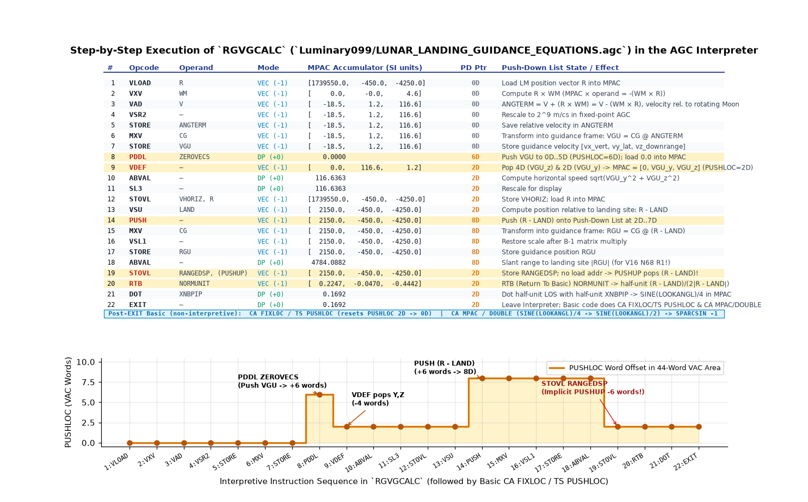

### `agc_03_dsky.py` — PINBALL GAME BUTTONS AND LIGHTS (The DSKY Interface)
Translates the `CHARIN` keypad interrupt handler and Verb/Noun display tables (`NNADTAB` for normal nouns and `IDADDTAB` for mixed nouns like `N68`). It walks through two iconic Apollo 11 Lunar Module DSKY sequences: keying `V16 N68 ENTR` during P63 braking to monitor slant range, time-to-go, and radar altitude residual `DELTAH`, followed by keying `V05 N09 ENTR` during the `1202` alarm to inspect `FAILREG` (`01202`) and pressing `RSET` / `KEY REL` to resume the interrupted monitor.

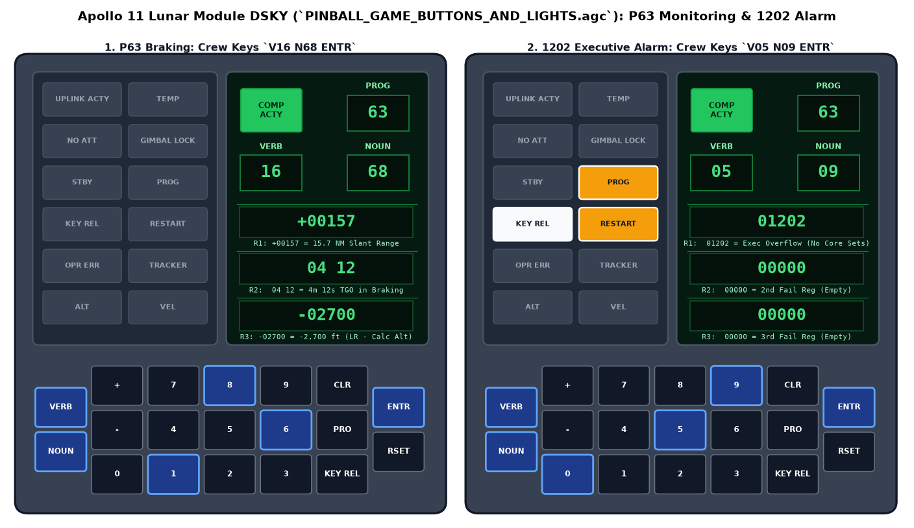

### `csm_01_earth_orbit_p11.py` — Saturn V Launch & Earth Orbit Insertion Monitor (P11)
During the Saturn V launch, the booster's Instrument Unit steered the vehicle while the Command Module Computer ran Program 11 (`P11.agc`) to monitor ascent and drive the FDAI attitude-error needles against a 6th-order pitch polynomial (`ATTDISP`). Every 2 seconds, `SERVICER207` integrates PIPA accelerometer increments and J2 oblate Earth gravity (`CALCRVG`), and `S11.1` (`VHHDOT`) updates DSKY `V06 N62` with inertial velocity `VI`, altitude rate `HDOT`, and altitude `H` above Pad 39A through Earth Orbit Insertion at 185.2 km (100 NM).

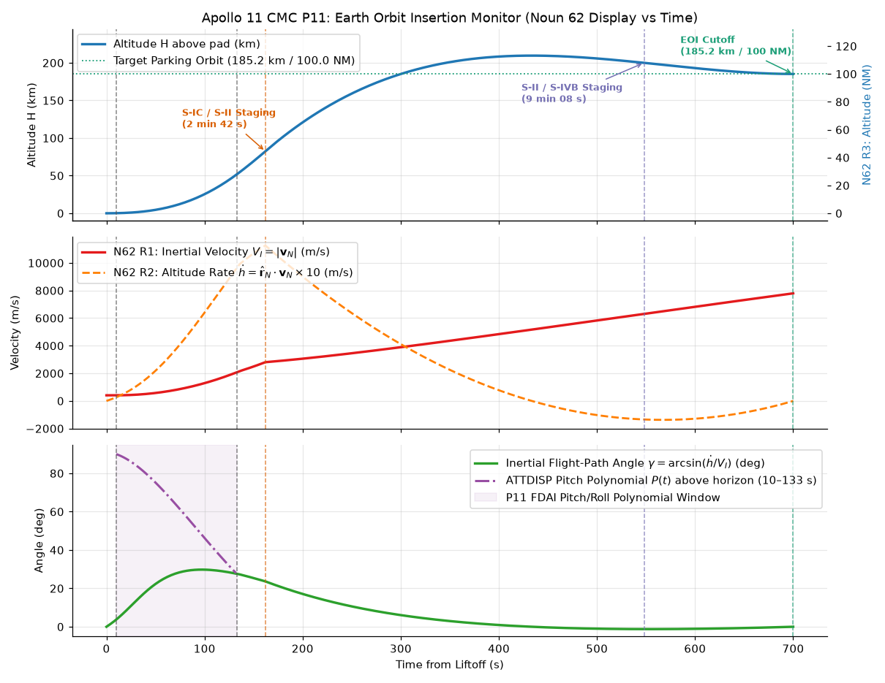

### `csm_02_conics_coast.py` — Translunar Coast, Universal Conics & Encke Integration
Translates `CONIC_SUBROUTINES.agc`, `TIME_OF_FREE_FALL.agc`, and `ORBITAL_INTEGRATION.agc`. It demonstrates the AGC's universal-variable Stumpff series (`DELTIME`), bounded-secant Kepler solver (`KEPLERN`/`ITERATOR`), `cot(gamma)` Lambert solver (`LAMBERT`/`INITV`), and closed-form time-of-free-fall (`CALCTFF`), then propagates a 145-hour circum-lunar free-return figure-8 trajectory using Encke's method with automatic reference-conic rectification (`RECTEST`/`RECTIFY`) and Earth/Moon Sphere-of-Influence switching (`ORIGCHNG` at `RSPHERE = 64,373.76 km`).

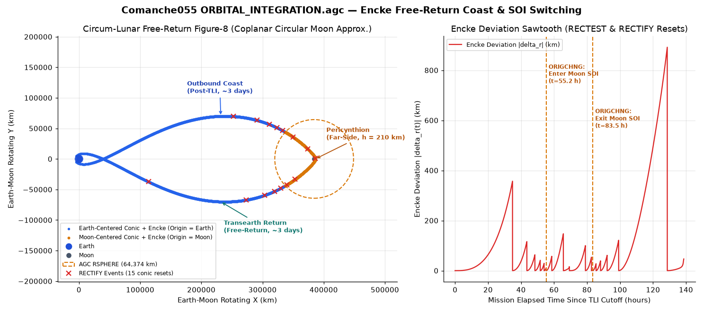

### `csm_03_imu_alignment_p52.py` — Optical Star Sightings & IMU Realignment (P52)
Before major burns, the navigator used Program 52 (`P51-P53.agc`) to correct the ~1 mrad/hr drift of the Inertial Measurement Unit's gyro-stabilized platform. This module decodes B-1 half-unit star vectors from `STAR_TABLES.agc`, simulates 5 sextant marks (`SXTMARK`) on Sirius (#15) and Regulus (#22), verifies the rigid-body Star Angle Difference check (`CHKSDATA`, Noun 05), and runs `AXISGEN` and `CALCGTA` (`INFLIGHT_ALIGNMENT_ROUTINES.agc`) to compute the Noun 93 gyro torquing angles that restore the platform to `REFSMMAT`.

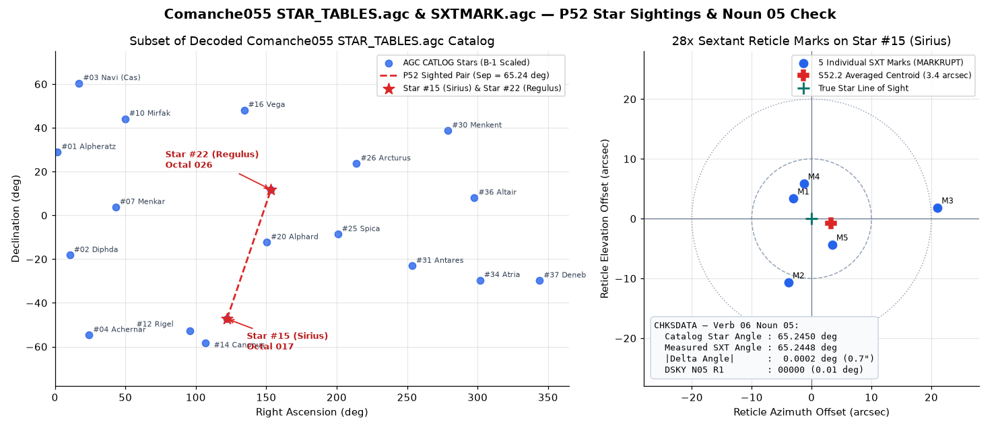

### `csm_04_burns_p30_p40.py` — Lunar Orbit Insertion (LOI-1) Targeting & SPS Burn (P30/P40)
Translates Program 30 (`P30-P37.agc`) and Program 40 (`P40-P47.agc`) for Apollo 11's 6-minute, 889 m/s retrograde Lunar Orbit Insertion burn behind the lunar far side. `S30.1` builds the Local Vertical frame at ignition (`LOMAT`) and previews post-burn apolune/perilune (`PERIAPO1`, Noun 44), while `S40.1` pre-rotates the initial thrust vector by half the burn's central angle and `S40.8` steers the Service Propulsion System every 2 seconds via cross-product steering (`XPRODUCT`, `TGOCALC`) to capture into a ~315 km x 105 km lunar orbit (Apollo 11 achieved ~315 km x 113 km). It also explains why the impulsive preview at ignition predicts a much lower perilune than the finite burn delivers.

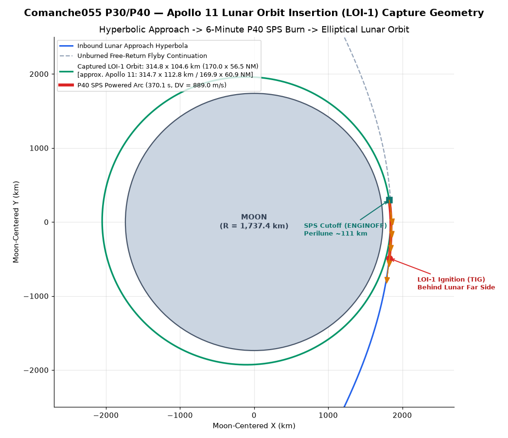

### `lm_01_powered_descent.py` — Eagle Powered Descent & Touchdown (P63–P66)
Translates `THE_LUNAR_LANDING.agc`, `LUNAR_LANDING_GUIDANCE_EQUATIONS.agc`, `THROTTLE_CONTROL_ROUTINES.agc`, and `SERVICER.agc` across all three landing phases from PDI (15.2 km altitude) to Tranquility Base. It models the 26-second 10% trim burn (`P63ZOOM`), 2-second `MUNRVG` integration with weighted Landing Radar altitude/velocity updates (`POSUPDAT`/`VELUPDAT`), Allan Klumpp's cubic `TTF/8` root finder (`ROOTPSRS`) and quadratic acceleration law (`QUADGUID`), `WHERETO` throttle-down, P64 Landing Point Designator angles (`LOOKANGL`), and Armstrong's P66 Rate-of-Descent (`RODCOMP`) manual landing.

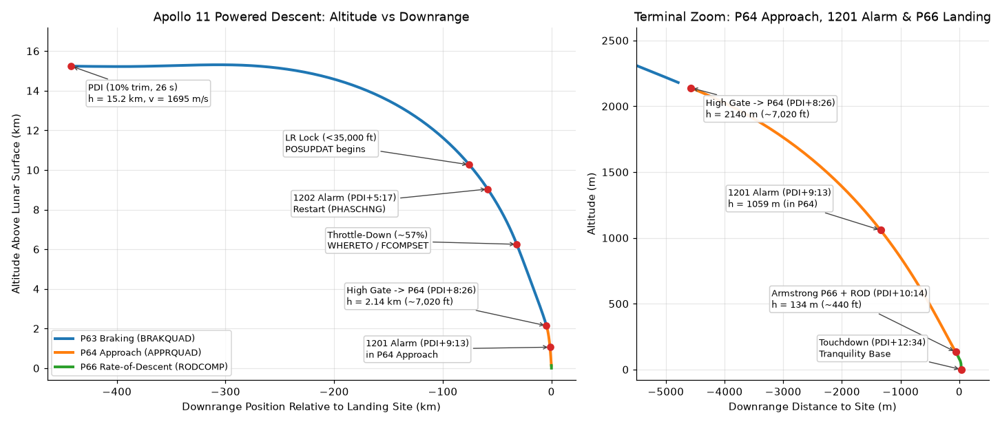

### `lm_02_ascent_p12.py` — Eagle Liftoff & Powered Ascent Guidance (P12)
Translates `P12.agc` and `ASCENT_GUIDANCE.agc` for the Lunar Module's single-engine ascent from Tranquility Base into a 17.4 km x 83.4 km lunar orbit. Because the 3,500 lbf Ascent Propulsion System is fixed-thrust, `ATMAG` filters 4 consecutive samples of `1/DV` to track burn-up time `TBUP = m/mdot`, while `ASCENT` holds a vertical rise until radial speed reaches 40 ft/s (`EXITVR`), solves logarithmic boundary-value integrals (`LOGSUB`, `RATES`, `CONST`) for linear-tangent steering, freezes rates at `TGO < 10 s`, and schedules engine cutoff at `TGO < 4 s` (`ENGOFF`).

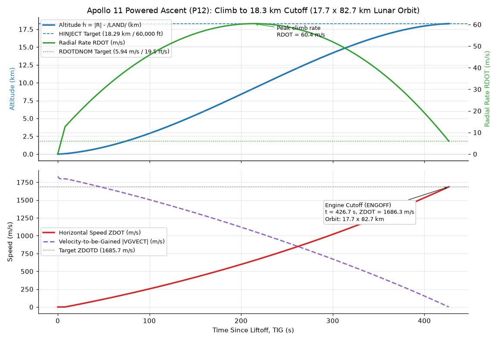

### `lm_03_rendezvous.py` — Lunar Orbit Rendezvous & Potter W-Matrix Kalman Filter
Translates the coelliptic rendezvous sequence (`P32` CSI -> `P33` CDH -> `P34` TPI at `E = 26.6 deg` -> `P35` midcourse/braking) alongside `P20`/`R22` Rendezvous Radar navigation (`LSR22.3` in `P20-P25.agc` and `INCORP1`/`INCORP2` in `MEASUREMENT_INCORPORATION.agc`). It also notes a classic codebase surprise: `KALMAN_FILTER.agc` (`RATELOOP`) is actually a tiny Digital Autopilot jet-torque rate filter, whereas James Potter's famous square-root covariance filter ($P = W W^T$, preserving positive-definiteness without matrix inversion or square roots of state matrices) lives in `MEASUREMENT_INCORPORATION.agc`.

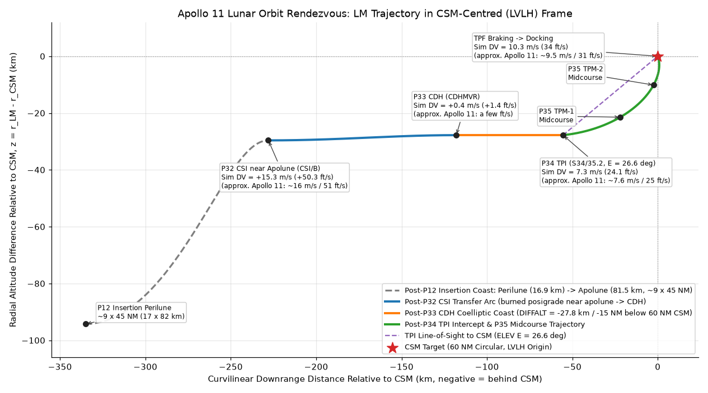

### `csm_05_entry_p61_p67.py` — Earth Atmospheric Entry & Double-Pulse Skip Guidance (P61–P67)
Translates `P61-P67.agc` and `REENTRY_CONTROL.agc` for *Columbia*'s 11.03 km/s lunar-return atmospheric entry from 400,000 ft Entry Interface until the computer stops steering (`STEEROFF`, below 1,000 ft/s); the drogue parachutes were deployed later, at ~24,000 ft, by the Earth Landing System rather than the AGC. Because the Command Module has a fixed hypersonic lift-to-drag ratio (`LAD = 0.30`), the AGC steers entirely by rolling the lift vector around the velocity vector (`LIMITL/D`, bank angle `ROLLC` from `0 deg` lift-up to `180 deg` lift-down) through `P63` initialization, `P64` pullout, `P65` upcontrol, `P66` ballistic skip, and `P67` reference-table range control (`PREDICT3`/`VREFER`), producing the signature Apollo double-pulse G-load profile.

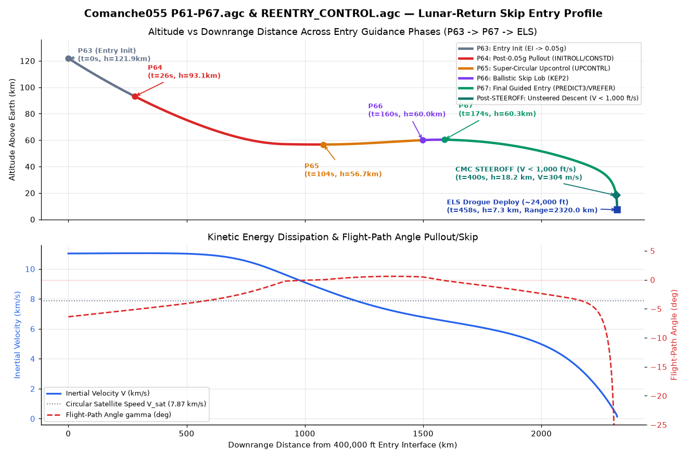

---

## Simplifications & Honesty

* **Floating-point translations, not cycle-accurate emulation:** Except in [`agc_00_numbers.py`](agc_00_numbers.py) (which explicitly implements 15-bit ones'-complement words and `B-n` fixed-point quantization), the physics and guidance equations are translated into standard Python/NumPy floating-point in SI units so you can read the math directly alongside the cited AGC assembly labels. (If you want a cycle-accurate Block II CPU emulator running the assembled rope binaries, see the [Virtual AGC (`yaAGC`)](https://www.ibiblio.org/apollo/) project.)
* **Planar / simplified environmental models where flagged:** Several walkthroughs use clearly flagged approximations for external environments not stored inside the AGC ROM—such as a 3-stage Saturn V booster acceleration profile in [`csm_01_earth_orbit_p11.py`](csm_01_earth_orbit_p11.py) (since the Saturn Instrument Unit steered the rocket), a circular lunar ephemeris in [`csm_02_conics_coast.py`](csm_02_conics_coast.py), a 2D downrange/altitude guidance plane in [`lm_01_powered_descent.py`](lm_01_powered_descent.py) and [`lm_02_ascent_p12.py`](lm_02_ascent_p12.py), Clohessy-Wiltshire relative motion in [`lm_03_rendezvous.py`](lm_03_rendezvous.py), and an exponential atmosphere in [`csm_05_entry_p61_p67.py`](csm_05_entry_p61_p67.py).
* **Every algorithm cites its exact assembly label:** Every translated function calls `src("Comanche055/...", "LABEL")` or `src("Luminary099/...", "LABEL")`, which asserts at runtime that the referenced `.agc` source file exists in this repository.
